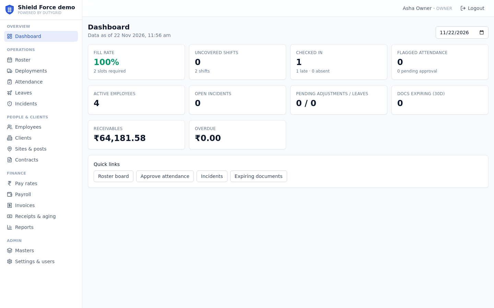
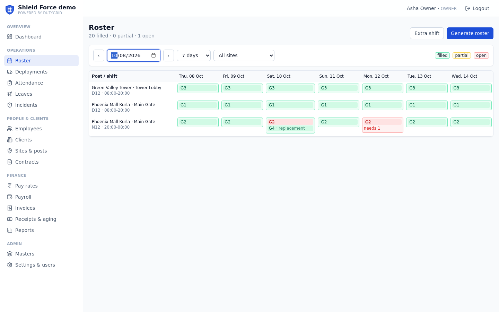
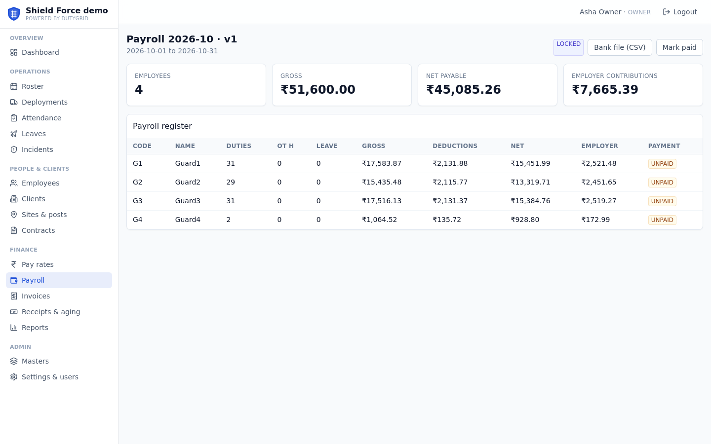
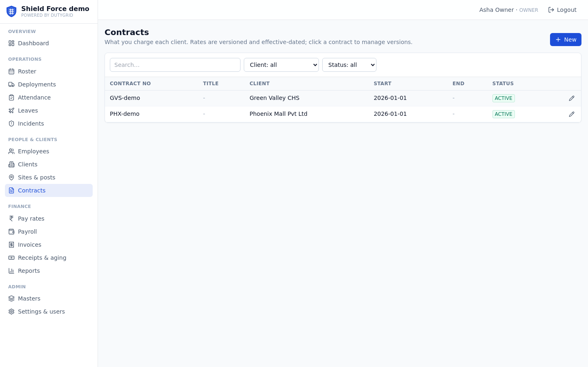
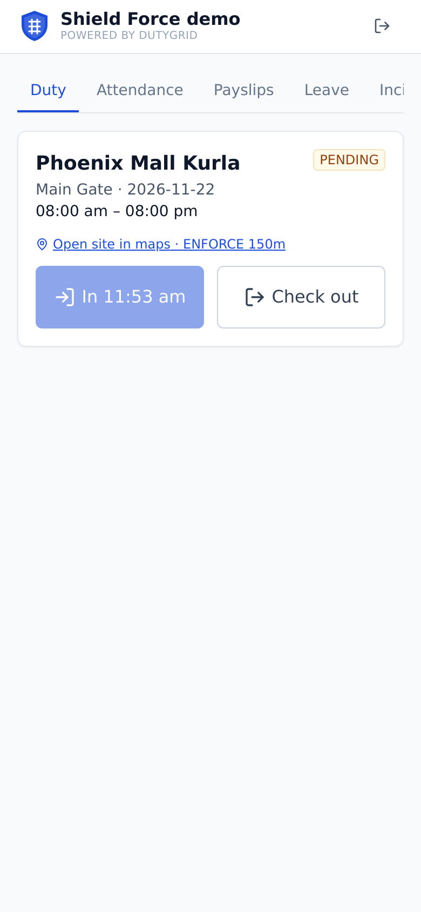

# User guide: one app, a view for every role

## Do we need separate apps?

**No. There is one web app for every user.** After login, each person lands on the screen for
their role and sees only what they're allowed to:

| Who | Device | Lands on | What they do |
|---|---|---|---|
| Agency owner / admin | Laptop | Dashboard | Everything: setup, approvals, finance, reports, users |
| Operations / supervisor | Laptop or phone | Roster | Deploy and transfer guards, fill open shifts, replacements, approve attendance, incidents |
| HR | Laptop | Employees | Onboarding, documents and verification, leave, guard logins |
| Finance | Laptop | Payroll / Invoices | Pay rates, payroll runs, invoices, receipts, margin |
| **Guard** | **Phone** | `/guard` | Today's duty, **Check in / Check out** (GPS), attendance, payslips, leave, report incident |
| **Client** (society / mall manager) | Phone or laptop | `/portal` | Guards on duty today, invoices, statement, incidents |
| Platform operator (you, the SaaS owner) | Laptop | `/platform` | Agencies, plans, suspend/restore (no access to their HR or finance data) |

### Installing on a phone (no app store needed)

The app can be installed as a phone app (a PWA):

* **Android (Chrome):** open the site, then menu ⋮ → **Install app** / **Add to Home screen**.
* **iPhone (Safari):** open the site, then Share → **Add to Home Screen**.

It opens full-screen with the agency's logo. The guard view keeps working offline: punches are
stored on the phone and sync automatically when the network returns.

### When would a separate native app be worth it?

Only if you later need things a browser can't do reliably:
* live GPS tracking in the background during a patrol, or NFC/QR checkpoint tags
* fingerprint or face check-in tied to the device
* guaranteed push notifications on iPhone when the app is closed

The backend already exposes everything over the same REST API, so a Flutter guard/supervisor app
(planned in the PRD) can be added later without backend changes.

## A typical month

1. **Setup (once):** Settings → Organisation & policies → Masters (branches, shift timings, worker types) → Clients → Sites & posts → Contracts (rates) → Pay rates.
2. **Hire:** Employees → add → upload documents → verify → **Activate** → create guard login.
3. **Deploy:** Deployments → post each guard at a site. Use **Transfer** when a guard moves (history is kept).
4. **Roster:** Roster → **Generate roster** for the month. Open slots show in red. Click a slot to see the best available replacement.
5. **Daily:** guards check in and out on their phones. Supervisors handle late arrivals and absences (**Replace**), and add extra shifts the client requests.
6. **Approvals:** Attendance → clean records are auto-approved. Review the flagged ones, and approve corrections (a different person must approve).
7. **Month end:**
   * Payroll → **New run** → review → approve (by someone else) → lock → bank file → mark paid.
   * Invoices → **Generate** per client → review → approve → issue → print/PDF → record payments in Receipts.
8. **Review:** Reports → **Site margin** shows what each site earned versus what its guards cost.

## Screens

| | |
|---|---|
| Dashboard  | Roster: replacement on 10 Oct, uncovered no-show on 12 Oct  |
| Attendance approvals  | Payroll register  |
| Invoice with uncovered-duty deduction and extra shift  | Site margin  |
| Contracts and versions  | Back office on a phone  |
| Guard phone view  | Client portal  |
